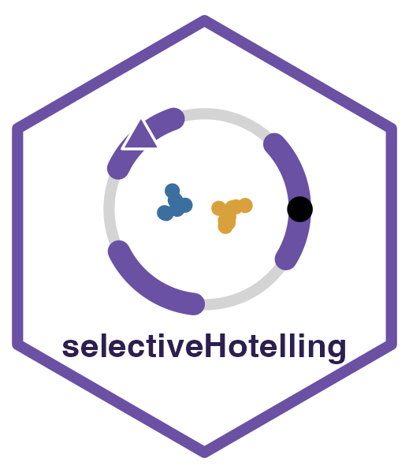

# selectiveHotelling 

Website and tutorials: <https://yiqunchen.github.io/selectiveHotelling/>

Selective inference for the difference in means between two estimated clusters, when the
covariance matrix of the features is **unknown**.

Clustering and then testing the clusters with a textbook two-sample test uses the data twice,
and the test rejects true null hypotheses far too often. `selectiveHotelling` computes
selective p-values that control the selective Type I error for **any** clustering algorithm
(k-means, hierarchical clustering, community detection, ...) without estimating the
covariance matrix.

## Installation

```r
# install.packages("remotes")
remotes::install_github("yiqunchen/selectiveHotelling")
```

The package depends only on base R.

## Quick start

```r
library(selectiveHotelling)

set.seed(1)
X <- rbind(matrix(rnorm(40), 20, 2),
           matrix(rnorm(40), 20, 2) + 5,
           matrix(rnorm(40), 20, 2) - 5)

res <- selective_hotelling_test(X, k1 = 1, k2 = 2, K = 3)   # k-means with K = 3
res$pval       # selective p-value for clusters 1 and 2
res$cluster    # the clusters that were tested

# hierarchical clustering
selective_hotelling_test(X, k1 = 1, k2 = 2, K = 3, clustering = "hclust")

# any clustering function that maps a data matrix to cluster labels
cl_fun <- function(x) cutree(hclust(dist(x), method = "complete"), k = 3)
selective_hotelling_bc(X, cl_fun, k1 = 1, k2 = 2)
```

The [package website](https://yiqunchen.github.io/selectiveHotelling/) has tutorials for k-means,
hierarchical clustering, arbitrary clustering algorithms, and the one-dimensional test, a real
data example, and the technical details. Its source is in
[`vignettes/articles/`](https://github.com/yiqunchen/selectiveHotelling/tree/main/vignettes/articles).

## Use with AI agents

The repository includes an [MCP](https://modelcontextprotocol.io) server, `mcp/server.R`, that lets
an agent cluster a data set and compute the selective p-values (tools `cluster_data`,
`selective_test`, `onedim_test`, `package_help`). It needs only R and `jsonlite`. Claude Code picks
it up from `.mcp.json` when started in a clone of this repository. To add it elsewhere:

```bash
claude mcp add selectiveHotelling -- Rscript /path/to/selectiveHotelling/mcp/server.R
```

Agent skills in `.claude/skills/` cover running the test correctly
(`selective-test-after-clustering`) and developing the package (`package-development`).
See [`mcp/README.md`](https://github.com/yiqunchen/selectiveHotelling/blob/main/mcp/README.md) and
[`.claude/skills/README.md`](https://github.com/yiqunchen/selectiveHotelling/blob/main/.claude/skills/README.md).

## Main functions

| Function | Purpose |
|---|---|
| `selective_hotelling_test()` | Selective test after k-means or hierarchical clustering |
| `selective_hotelling_bc()` | Selective test after any clustering function |
| `selective_truncated_F()` | One-dimensional selective test (faster, conditions on more) |
| `hotelling_T2()` | Two-sample Hotelling statistic for a pair of clusters |

## Reference

Chen, Y. T. and Gao, L. L. Selective inference for clustering under unknown covariance.
Code that reproduces the paper: <https://github.com/yiqunchen/selectiveHotelling-paper>.

## License

MIT
