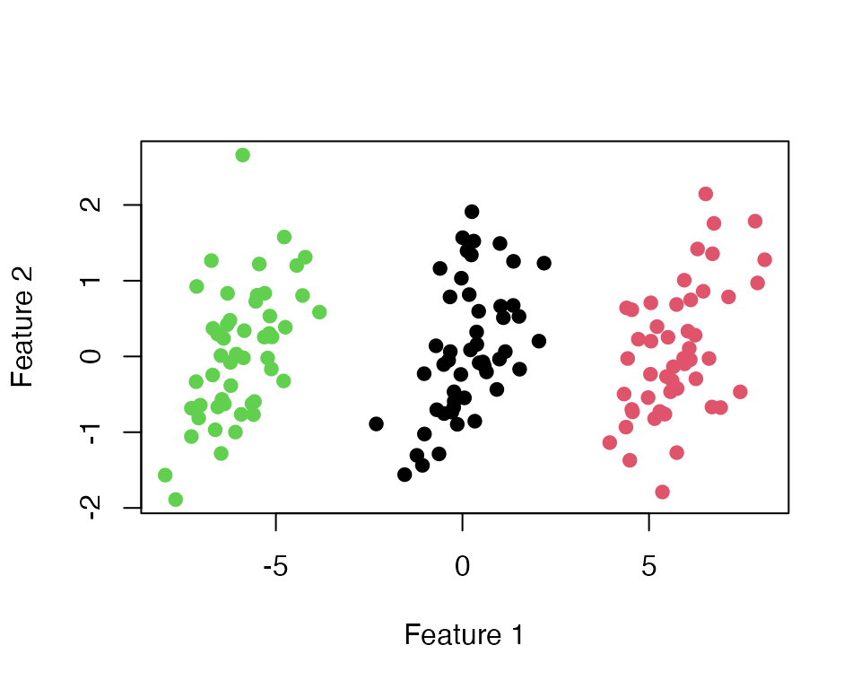

# Tutorial: -means clustering

``` r

library(selectiveHotelling)
```

## Simulated data

We generate $`n = 150`$ observations in $`p = 2`$ dimensions from three
groups of $`50`$, whose means differ by $`6`$ along the first feature.
The two features are correlated, and the analysis below never uses their
covariance matrix.

``` r

set.seed(123)
n_per <- 50
Sigma <- matrix(c(1, 0.6, 0.6, 1), 2, 2)
noise <- matrix(rnorm(3 * n_per * 2), ncol = 2) %*% chol(Sigma)
mu <- rbind(c(-6, 0), c(0, 0), c(6, 0))[rep(1:3, each = n_per), ]
X <- mu + noise
true_group <- rep(1:3, each = n_per)
```

## Cluster and test

[`selective_hotelling_test()`](https://yiqunchen.github.io/selectiveHotelling/reference/selective_hotelling_test.md)
runs $`k`$-means with $`K`$ clusters and tests the null hypothesis that
clusters `k1` and `k2` share one mean. It returns the selective
$`p`$-value and the clustering that was tested.

``` r

set.seed(1)   # fixes the random initial centers of k-means
res12 <- selective_hotelling_test(X, k1 = 1, k2 = 2, K = 3, M = 1000)
res12
#> Selective Hotelling T^2 test (unknown covariance)
#>   Clusters tested : 1 vs 2 (of K = 3)
#>   Sampler         : besag-clifford
#>   Conditioning    : pair-preserved
#>   Observed T^2    :  1195
#>   Selective p-val : 0.004965 (MC s.e. ~ 0.002)
```

The default path length is `M = 5000`; we use `M = 1000` in this
tutorial so that it runs quickly; the [technical
details](https://yiqunchen.github.io/selectiveHotelling/articles/technical_details.md)
explain this choice. The estimated clusters agree with the true groups:

``` r

table(cluster = res12$cluster, true_group)
#>        true_group
#> cluster  1  2  3
#>       1  0 50  0
#>       2  0  0 50
#>       3 50  0  0
```

``` r

plot(X, col = res12$cluster, pch = 19, xlab = "Feature 1", ylab = "Feature 2",
     main = "")
```



## Compare with the naive test

The naive test applies Hotelling’s $`T^2`$ test to the estimated
clusters as if they had been chosen in advance. We compute it for every
pair of clusters, next to the selective test.

``` r

naive_pval <- function(X, cl, k1, k2) {
  n1 <- sum(cl == k1); n2 <- sum(cl == k2); p <- ncol(X); r <- n1 + n2
  F_stat <- (r - p - 1) / ((r - 2) * p) * hotelling_T2(X, cl, k1, k2)
  pf(F_stat, p, r - p - 1, lower.tail = FALSE)
}

pairs <- rbind(c(1, 2), c(1, 3), c(2, 3))
results <- t(apply(pairs, 1, function(k) {
  set.seed(1)   # the same initial centers, so the same clustering, for every pair
  sel <- selective_hotelling_test(X, k[1], k[2], K = 3, M = 1000)
  c(k1 = k[1], k2 = k[2], naive = naive_pval(X, sel$cluster, k[1], k[2]),
    selective = sel$pval)
}))
signif(results, 3)
#>      k1 k2    naive selective
#> [1,]  1  2 4.64e-55   0.00497
#> [2,]  1  3 8.41e-60   0.00596
#> [3,]  2  3 1.24e-84   0.00397
```

Both tests reject every null hypothesis here, because the three groups
really differ. The difference between the tests appears when there are
no groups at all.

## Data with no groups

Now all $`n = 150`$ observations come from one Gaussian distribution, so
every null hypothesis is true.

``` r

set.seed(321)
X0 <- matrix(rnorm(150 * 2), ncol = 2) %*% chol(Sigma)
res0 <- selective_hotelling_test(X0, k1 = 1, k2 = 2, K = 3, M = 1000)
c(naive = naive_pval(X0, res0$cluster, 1, 2), selective = res0$pval)
#>        naive    selective 
#> 2.023292e-26 3.001798e-01
```

The naive $`p`$-value is tiny, although the clusters are only an
artifact of $`k`$-means. The selective $`p`$-value is not.

## Repeating the experiment

To see that this is not a coincidence, we repeat the null experiment
$`300`$ times with $`n = 60`$ and plot the quantiles of the $`p`$-values
against those of the uniform distribution. We skip the rare data sets in
which a tested cluster has fewer than three observations, for which
Hotelling’s $`T^2`$ is not defined. A test that controls the Type I
error has $`p`$-values on or above the diagonal.

``` r

set.seed(2024)
sim <- t(replicate(300, {
  Xs <- matrix(rnorm(60 * 2), ncol = 2) %*% chol(Sigma)
  rs <- tryCatch(selective_hotelling_test(Xs, k1 = 1, k2 = 2, K = 3, M = 200),
                 error = function(e) NULL)   # skip the rare data sets with a tiny cluster
  if (is.null(rs)) c(naive = NA, selective = NA)
  else c(naive = naive_pval(Xs, rs$cluster, 1, 2), selective = rs$pval)
}))
sim <- sim[complete.cases(sim), ]
nrow(sim)
#> [1] 299
u <- ppoints(nrow(sim))
plot(u, sort(sim[, "naive"]), pch = 19, col = "black", xlim = c(0, 1), ylim = c(0, 1),
     xlab = "Uniform(0, 1) quantiles", ylab = "p-value quantiles")
points(u, sort(sim[, "selective"]), pch = 19, col = "steelblue")
abline(0, 1, lty = 2)
legend("topleft", c("naive", "selective"), col = c("black", "steelblue"), pch = 19,
       bty = "n")
```


``` r

colMeans(sim <= 0.05)
#>     naive selective 
#> 1.0000000 0.0735786
```

At level $`0.05`$, the naive test rejects 100% of these true null
hypotheses and the selective test 7.4%. With about $`300`$ data sets,
the second number has a Monte Carlo standard error of about $`1.3`$
percentage points; in a run with $`2{,}000`$ data sets, the selective
test rejected $`4.7\%`$.

## Fixing the $`k`$-means initialization

$`k`$-means depends on its random initial centers.
[`selective_hotelling_test()`](https://yiqunchen.github.io/selectiveHotelling/reference/selective_hotelling_test.md)
draws the initial centers once, from the current random seed, and reruns
$`k`$-means from the same centers inside the test; set a seed before
calling it to make the result reproducible. To choose the initial
centers yourself, pass a clustering function to
[`selective_hotelling_bc()`](https://yiqunchen.github.io/selectiveHotelling/reference/selective_hotelling_bc.md),
as in [the tutorial for other clustering
algorithms](https://yiqunchen.github.io/selectiveHotelling/articles/Tutorials_any.md):

``` r

init <- c(1, 51, 101)                       # rows used as initial centers
cl_fun <- function(x) kmeans_with_fixed_init(x, init_centers_idx = init)$cluster
selective_hotelling_bc(X, cl_fun, k1 = 1, k2 = 2, M = 1000)$pval
#> [1] 0.006090536
```
